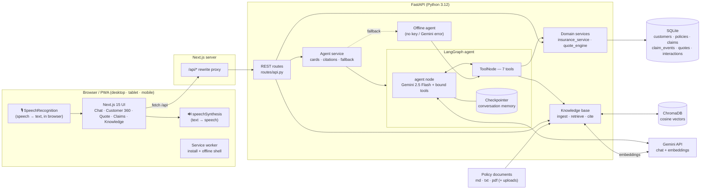
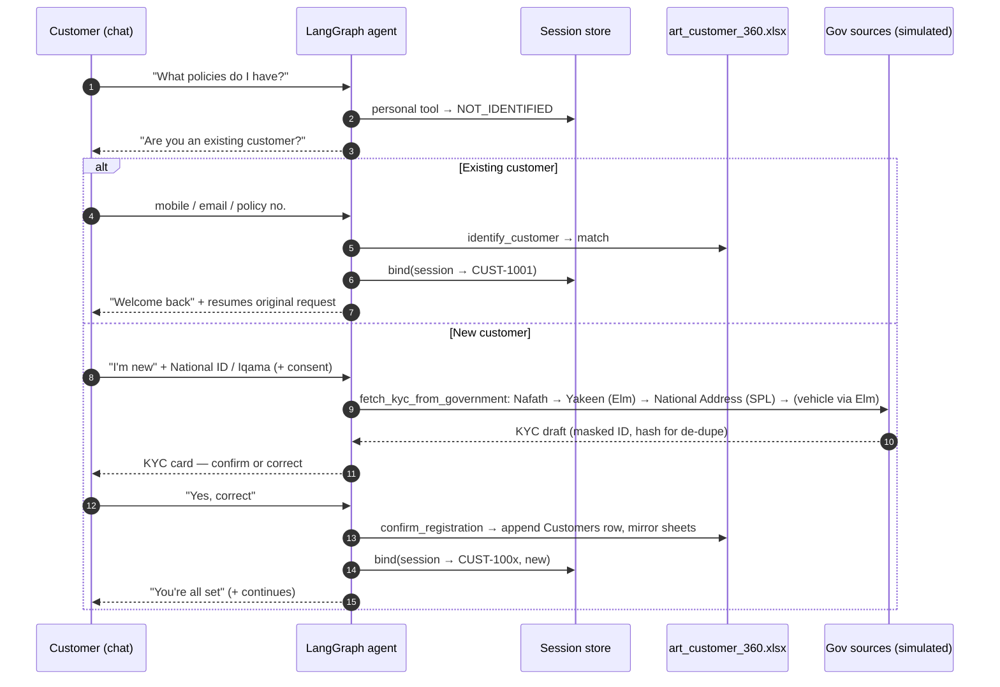
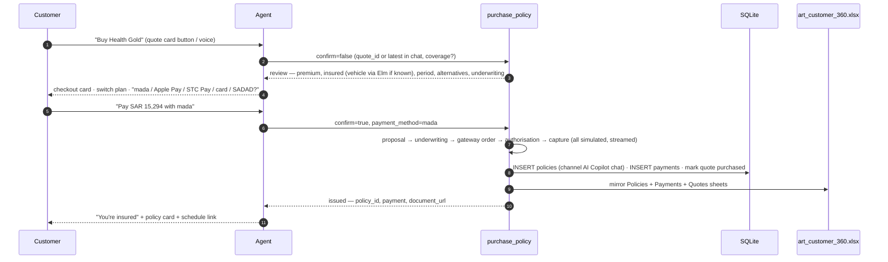
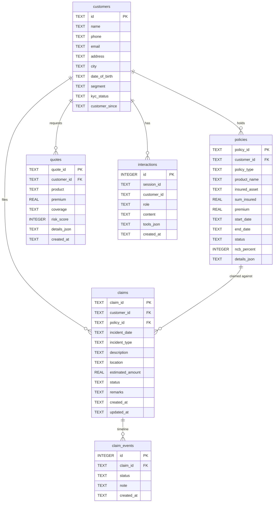
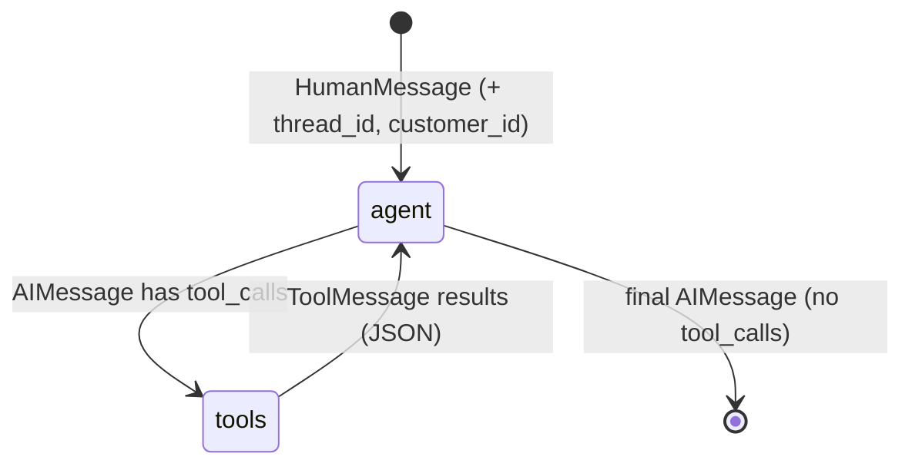

# Al Rajhi Takaful AI Voice Copilot — Architecture (Saudi Arabia, individual plans)

> Current scope: individual Takaful plans in five portfolios (Motor, Health, Life, Retirement & Savings, General). Conversation order: portfolio → name → National ID / Iqama → plate (motor) → Nafath/Yakeen/Elm (simulated) → only the remaining product questions → quote → checkout. Replies are kept to 1–2 sentences; greetings use Arabic ("Ahlan wa sahlan"). Speech uses a neural voice from the backend (`/api/tts`, edge-tts) with browser fallback.

## 1. Solution architecture



**Key design decisions**

| Decision | Why |
|---|---|
| Voice entirely in the browser | Zero infra cost, no audio leaves the device to our servers, instant start. Abstracted behind two hooks so Google Cloud STT/TTS or Gemini Live can replace it later. |
| One `services/` layer used by both REST routes and agent tools | The LLM never computes premiums or writes SQL. Deterministic, testable business rules; the agent orchestrates. |
| Customer id injected via `RunnableConfig`, not a tool argument | The model cannot be prompted into reading another customer's data. |
| Tools return JSON → backend turns them into typed **cards** | Rich, consistent UI (quote, claim timeline, renewal…) independent of how the model phrases its reply; the spoken reply stays short. |
| Offline agent fallback | Leadership demos don't die on a quota error or bad Wi-Fi. |
| Next.js rewrite proxy | Single origin → no CORS, phones use one URL, backend not exposed publicly. |

---

## 1b. Customer identity & onboarding



- The **browser never sends a customer id**. The session store (keyed by chat `session_id` = LangGraph `thread_id`) is the single source of truth; every personal-data tool reads it and refuses with `NOT_IDENTIFIED` until verified.
- The system prompt is rebuilt **every agent step** with the session's identity, so verification inside a turn takes effect immediately.
- **Privacy:** National ID / Iqama numbers are never stored in clear — only a masked reference and a salted SHA-256 prefix (`id_hash`) used to detect duplicate registrations. ID numbers are masked in the progress panel and tool-usage badges.
- Government lookups are **simulated** (`identity_service.MOCK_REGISTRY` + deterministic generator) with realistic latency so the panel shows each source; swap in the real Nafath, Yakeen (Elm), National Address (SPL) and vehicle-registration APIs behind the same functions.
- Tools stream sub-steps via LangGraph's custom stream writer (`stream_mode=["updates","custom"]`) → SSE `tool_progress` events. The offline agent runs in a worker thread with a queue sink so its events are live too.

**Customer 360 store (`services/excel_store.py`)** — `art_customer_360.xlsx` with sheets *Customers* (master, read + append, external edits picked up by file mtime), *Policies*, *Claims*, *Quotes* (mirrored from SQLite after every write) and *About*. Writes are atomic (temp file + `os.replace`); if Excel holds the file lock, the change stays in memory with `pending_sync` and flushes on the next write or `POST /api/console/excel/sync`.

**Products & rating (`services/products.py`)** — one registry over five individual portfolios. Each line provides a deterministic rating engine returning the same quote shape (`line, params, subject, sum_insured_label, breakdown[], gst_note, plan, coverage, alternatives[], recommendation, risk`), a plan normaliser, underwriting rules and how a purchased policy is recorded:

| Line | Engine | Tool | Policy type / prefix |
|---|---|---|---|
| Health | `health_engine.py` — individual: age-band base, plan tier (Class C/B/VIP), city factor, chronic-condition loading, 15% VAT | `generate_health_quote` | Health · `POL-HLT` |
| Motor | `quote_engine.py` — market value × OD rate × zone, TPL tariff, No Claim Discount (15–30%), agency-repair add-on, 15% VAT; vehicle type/age come from the Elm record (`lookup_vehicle`) | `generate_quote` | Motor - Car / Motorcycle · `POL-MTR` `POL-MC` |
| Retirement & Savings | `savings_engine.py` — monthly contribution × term into Shariah funds, admin fee by plan, illustrative 3/5/7% projections, Takaful protection, **VAT-exempt** | `generate_savings_quote` | Retirement & Savings · `POL-SAV` (runs for the full term) |
| Life | `life_engine.py` — sum assured × mortality rate at mid-term age × smoker loading × plan riders, **VAT-exempt** | `generate_life_quote` | Life · `POL-LIF` (policy runs for the full term) |
| General | `home_engine.py` — building & contents rates per SAR 1,000, villa and flash-flood loadings, tier, 15% VAT | `generate_general_quote` | General - Home · `POL-GEN` |

**Insurer persona** — `INSURER_NAME` drives the system prompt ("you are {insurer}'s own assistant… only recommend our products, never other insurers"), offline replies, knowledge documents (`{{INSURER}}` substituted at ingestion), the policy schedule and the UI brand.

**Policy purchase (`services/purchase_service.py`, tool `purchase_policy`)**



- Two-step tool so payment always needs an explicit second call after the customer chooses a method; the offline agent and the prompt both enforce this.
- Underwriting runs at review time so problems surface *before* payment: KYC must be Verified (expired Iqama → refused); agency repair ≤ 5-year-old vehicles; health > 65 and life > 55 / > SAR 3M referred; quote validity 15 days; one purchase per quote.
- Switching plan re-prices the same vehicle through the rating engine (new linked quote). Guest quotes are re-assigned to the customer once verified.
- `payments` table: `payment_id, customer_id, policy_id, quote_id, amount, method, status, reference, gateway, created_at`.
- `GET /api/policies/{id}/document` renders a printable HTML policy schedule (watermarked as a demo document).

**Customer app vs staff console** — `src/app/(customer)` (Home, Chat — chatbot only) and `src/app/console` (Customer 360, Claims, Quotes, Knowledge). The console is not linked from the customer app; in production it would sit behind staff SSO.

## 2. Frontend structure

```
frontend/src/
├── app/                         App Router pages
│   ├── layout.tsx               html shell, theme bootstrap, AppShell
│   ├── page.tsx                 Home: hero, CTA, example prompts, journeys, recent interactions
│   ├── chat/page.tsx            AI chat (Suspense → ChatView)
│   ├── customer/page.tsx        Customer 360
│   ├── quote/page.tsx           Interactive quotation
│   ├── claims/page.tsx          Create · Track · View claims
│   ├── knowledge/page.tsx       RAG Q&A + uploads + sources
│   ├── manifest.ts              PWA manifest
│   └── globals.css              Tailwind v4 theme tokens, glass utilities, dark mode
├── components/
│   ├── app-shell.tsx            sidebar (md+), mobile top bar, bottom nav with sticky mic FAB
│   ├── voice-orb.tsx            VoiceOrb (idle/listening/processing/speaking), VoiceStatus, Waveform
│   ├── page-header.tsx          PageHeader, PageContainer, Skeleton, ErrorBanner
│   └── ui/                      shadcn/ui primitives: button, card, badge, input/select/textarea
├── features/
│   ├── chat/                    chat-view, message-bubble (markdown, tool badges, play/stop), card-renderer, citations
│   ├── quote/quote-result.tsx   quote card + animated risk gauge
│   ├── claims/claim-timeline.tsx 5-stage timeline + claim summary card
│   └── policies/policy-cards.tsx policy rows, renewal card
├── hooks/
│   ├── use-speech-recognition.ts  mic permission, start/stop/toggle, interim transcript, error mapping
│   └── use-speech-synthesis.ts    voice selection, markdown→speech cleaning, chunking, stop/replay
├── services/api.ts              typed API client
├── types/index.ts               shared TS types
└── lib/utils.ts                 cn(), SAR formatting, dates
```

## 3. Backend structure

```
backend/app/
├── main.py                      FastAPI app; lifespan: init_db → kb.load → agent_service.init
├── config.py                    env settings, data dirs
├── agents/
│   ├── graph.py                 LangGraph StateGraph (agent ⇄ tools) + MemorySaver
│   ├── prompts.py               system prompt (customer + date context, workflows, voice style)
│   └── offline_agent.py         slot-filling fallback agent using the same tools
├── tools/insurance_tools.py     generate_quote · get_customer_profile · get_policy_details ·
│                                create_claim · track_claim · renew_policy · knowledge_search
├── database/
│   ├── db.py                    schema DDL, connection ctx manager, JSON row mapping
│   └── seed.py                  realistic mock data with dates relative to today
├── rag/
│   ├── ingest.py                load (md/txt/pdf) → heading-aware chunking → ids/metadata
│   ├── knowledge_base.py        Chroma sync (incremental), vector search, keyword fallback, uploads
│   └── documents/               motor guide · claim process · policy servicing · FAQs · T&Cs
├── routes/api.py                REST API
├── schemas/models.py            Pydantic request/response models
└── services/
    ├── gemini_service.py        reusable Gemini chat model + embeddings + one-shot generate
    ├── agent_service.py         runs the graph, extracts tool calls → cards/citations, fallback, logging
    ├── insurance_service.py     customers, 360, policies, renewals, quotes, claims, interactions
    ├── quote_engine.py          deterministic motor rating (market value, OD, TPL, NCD, agency repair, VAT, risk score)
    └── knowledge_service.py     RAG answerer for the Knowledge page (grounded, cited)
```

---

## 4. Database schema (SQLite)



All columns required by the brief are present (`customers.id/name/phone/email/address`, `policies.policy_id/customer_id/policy_type/premium/start_date/end_date/status`, `claims.claim_id/customer_id/incident_date/status/remarks`, `quotes.quote_id/customer_id/premium/coverage/created_at`); extra columns power the richer demo. Customers live in `art_customer_360.xlsx` (seeded with 3); SQLite seed data: 6 policies (one expiring in 18 days, one lapsed), 4 claims across all stages with event history, 3 quotes. Dates are computed relative to today so the demo never goes stale.

Claim lifecycle: `Reported → Under Review → Assessment → Approved → Closed` (each transition writes a `claim_events` row; `/claims/{id}/advance` simulates the back office).

---

## 5. API design

Base path `/api`. OpenAPI/Swagger at `/docs`.

| Method | Path | Purpose |
|---|---|---|
| GET | `/health` | Agent mode (gemini/offline), retrieval mode (vector/keyword), model, chunk count |
| POST | `/chat/stream` | **SSE** — same body as `/chat`; streams `run_started`, `step`, `tool_call`, `tool_result`, `notice`, `final` events (powers the *What's happening* panel) |
| POST | `/chat` | `{message, session_id?, customer_id?}` → `{reply, session_id, tools_used[], cards[], citations[], mode, notice}` |
| DELETE | `/chat/{session_id}` | Clear conversation memory |
| GET | `/interactions/recent` | Recent prompts + replies + tools (Home page) |
| GET | `/chat/{session_id}/identity` | Who this chat is verified as (`guest` / `kyc_pending` / `verified`) |
| GET | `/console/overview` | Console: customers from Excel, active verified chat sessions, Excel sync status |
| GET | `/console/customer-360.xlsx` | Download the Customer 360 workbook |
| POST | `/console/excel/sync` | Flush pending writes to the workbook |
| POST | `/quotes/{line}` | Quote any line: `{customer_id?, plan?, params{…}}` for `motor`, `health`, `home` |
| GET | `/products` | Online product catalogue |
| POST | `/purchase` | Checkout: `{quote_id?, coverage?, confirm, payment_method?, registration_number?}` → review or issued policy |
| GET | `/payments?customer_id=` | Simulated payment transactions |
| GET | `/policies/{id}/document` | Printable policy schedule (HTML) |
| GET | `/customers` | List customers (from Excel) |
| GET | `/customers/{id}/360` | Profile, KPIs, policies, claims, quotes, renewals, recommended actions |
| GET | `/policies?customer_id=` | Policies with `days_to_expiry`, `renewal_due` |
| GET | `/policies/{id}` | One policy |
| GET | `/policies/{id}/renewal-quote` | Renewal premium, No Claim Discount change, new period, recommendation |
| POST | `/policies/{id}/renew` | `{confirm}` — `false` = quote, `true` = issue renewed policy (mock payment) |
| POST | `/quotes` | `{vehicle_type, vehicle_age, coverage, location, ncb_percent?}` → full quotation |
| GET | `/quotes?customer_id=` | Previous quotations |
| POST | `/claims` | `{description, incident_date?, location?, policy_id?, incident_type?, estimated_amount?}` → claim + timeline + next steps |
| GET | `/claims?customer_id=` · `/claims/{id}` | List / track |
| POST | `/claims/{id}/advance` | Demo: move to next stage |
| POST | `/knowledge/ask` | `{question, k?}` → `{answer, sources[], mode, retrieval}` |
| POST | `/knowledge/upload` | multipart `file` (.pdf/.md/.txt ≤10 MB) → chunk + embed + index |
| GET | `/knowledge/sources` | Indexed documents |
| POST | `/knowledge/reindex` | Rebuild the vector store |

Errors: `404` not found, `400` validation/business rule (e.g. incident date outside policy period), `422` schema.

**Chat card contract** — the frontend renders by `type`:

| Tool | Card `type` | `data` |
|---|---|---|
| generate_quote | `quote` | QuoteResult |
| get_customer_profile | `profile` | Customer360 |
| get_policy_details | `policies` | Policy[] or Policy |
| create_claim / track_claim | `claim` | Claim or Claim[] |
| renew_policy | `renewal` | RenewalResult (`status: quote|renewed`) |
| knowledge_search | → `citations[]` | ranked passages with `ref`, `source`, `section` |
| identify_customer | `identity` | `{found, customer}` |
| fetch_kyc_from_government | `kyc` | `{draft{name, dob, address, phone, id_reference, vehicle, lookups[]}}` or `{already_registered}` |
| purchase_policy | `purchase` | `{status: review|issued, plan, total_premium, insured_asset, alternatives, underwriting, policy_id?, payment?, document_url?, excel?}` |
| confirm_registration | `registered` | `{registered, customer, excel{synced, warning}}` |

---

## 6. LangGraph workflow



- **State:** `MessagesState` (full message list). **Memory:** `MemorySaver` checkpointer keyed by `thread_id = session_id`, so "yes, renew it" resolves against the previous turn. Swap to `SqliteSaver`/`PostgresSaver` for durability.
- **agent node:** prepends a fresh system prompt (customer name/id, today's date, workflows, voice style) and the last 40 messages, calls Gemini 2.5 Flash with `bind_tools(ALL_TOOLS)`.
- **tools node:** `ToolNode` executes one or more tool calls (parallel calls supported), results go back to the agent.
- **Guard rails:** recursion limit 12; tools return `{ok:false,error}` instead of raising, so the model can recover ("that date is outside your policy period — when did it happen?"); renewal requires a confirm step; claims and quotes are created only by tools.

**Workflow examples (as implemented in the prompt + tools)**

```
Recommendation/Quote   user → agent asks type/age → city → cover (or "recommend")
                       → generate_quote → summary + recommended plan → quote card
Claim                  user "I had an accident" → empathy + when → where → what happened
                       → create_claim → claim ID + status + next steps → timeline card
Renewal                user "renew my policy" → get_policy_details (soonest expiry)
                       → renew_policy(confirm=false) → old vs new premium, NCD → "confirm?"
                       → renew_policy(confirm=true) → new policy number + payment ref
Knowledge              user question → knowledge_search → grounded answer with [n] citations
```

---

## 7. Gemini integration

`services/gemini_service.py` is the single integration point:

```python
get_chat_model()      # ChatGoogleGenerativeAI(model="gemini-2.5-flash", temperature, retries, timeout)
get_embeddings()      # GoogleGenerativeAIEmbeddings(model="models/gemini-embedding-001")
generate(prompt, system)          # one-shot (Knowledge page)
embed_documents(texts) / embed_query(text)
text_of(content)      # normalises Gemini's str | list-of-parts content
```

Tool calling uses LangChain's `bind_tools`, which converts the typed, documented Python tools into Gemini function declarations. Conversation memory is LangGraph's checkpointer. The system prompt embeds the brief's prompt verbatim plus workflow and voice-style rules (`agents/prompts.py`).

## 8. RAG pipeline (ChromaDB)

```
Ingestion  documents/*.md + data/uploads/* ─► load (pypdf for PDF) ─► heading-aware chunks (~1,100 chars, 150 overlap)
           ─► id = file::section.part::sha1 ─► embed missing chunks only (batches of 50) ─► Chroma upsert, delete stale
Retrieval  query ─► embed_query ─► Chroma cosine kNN (k=4) ─► passages with ref/source/section/score
Answering  numbered context ─► Gemini "answer only from context, cite [n]" ─► answer + sources (cited flag)
Fallback   BM25-style keyword ranking over the same chunks + extractive answer (no key / API error)
```
Incremental sync means restarts don't re-embed unchanged documents; uploads are searchable immediately from both the Knowledge page and the chat agent.

## 9. Voice integration

| Concern | Implementation (`hooks/`) |
|---|---|
| Permission | `getUserMedia({audio:true})` once to trigger the prompt predictably, tracks stopped immediately |
| Start / stop | `SpeechRecognition` (or `webkitSpeechRecognition`), `interimResults` for live transcript, auto-stop on silence; tap orb to stop early |
| Transcript display | interim + final text in the listening bar with animated waveform; final text auto-sent |
| Speak | neural voice from `POST /api/tts` (edge-tts, `en-US-AvaMultilingualNeural` / `ar-SA-ZariyahNeural`), falling back to `speechSynthesis` with the best local voice (Edge "Natural" voices ranked first); markdown stripped, "SAR 24,860" → "24,860 riyals", IDs spelled out, chunked by sentence (avoids Chrome's ~15 s cut-off) |
| Stop / replay | per-message Play/Stop, header Replay, auto-speak toggle (persisted) |
| Barge-in | starting the mic cancels speech; sending a new message stops speech |
| States | `idle · listening · processing · speaking` drive VoiceOrb colour/animation and the status pill |

## 10. UI wireframes

**Desktop — Chat with live "What's happening" panel** (matches the supplied wireframe: top bar, conversation left, progress sidebar right — collapsible; a slide-over drawer below 1024 px)
```
┌──────────────────────────────────────────────────────────────────────────────┐
│ 🛡 Insurance AI Copilot   💬 🧮 👤 ⚠ 📖                        [🎙 Talk] ☀ (AS) │
└──────────────────────────────────────────────────────────────────────────────┘
┌──────────────────────────────────────────────┐ ┌───────────────────────────┐
│ AI Copilot ● Thinking…      ⟲  🔊  New chat  │ │ ✦ What's happening      ⇥ │
│──────────────────────────────────────────────│ │ "Renew my policy"         │
│                       ┌──────────────────┐   │ │ ⟳ Working · 2.4s          │
│                       │ Renew my policy  │   │ │ gemini-2.5-flash · 2 tools│
│                       └──────────────────┘   │ │ ✓ Understanding request   │
│ 🛡 ●●● Calculating renewal…                   │ │ ✓ Gemini planning   0.9s  │
│                                              │ │ 🔧 Looking up policies    │
│                                              │ │    3 active · 1 due  0.1s │
│                                              │ │ ⟳ Calculating renewal ▾   │
│                                              │ │    policy_id: POL-TW-…    │
│ ┌──────────────────────────────────────────┐ │ │ ─ Earlier in this chat ─  │
│ │(🎙) Ask anything, or tap the mic…      (➤)│ │ │ "What policies…" 1.2s     │
│ └──────────────────────────────────────────┘ │ │ LangGraph · 7 tools       │
└──────────────────────────────────────────────┘ └───────────────────────────┘
```

**Desktop — Chat (earlier sidebar variant, for reference)**
```
┌──────────────┬──────────────────────────────────────────────────────────────┐
│ 🛡 Insurance  │  AI Copilot  ● Ready                     ⟲ Replay  🔊  New chat │
│   AI Copilot │ ───────────────────────────────────────────────────────────── │
│              │                                  ┌──────────────────────────┐ │
│ ⌂ Home       │                                  │ 🎙 I need insurance for…  │ │
│ 💬 AI Copilot│                                  └──────────────────────────┘ │
│ 👤 Customer  │ 🛡 [🔧 Generate Quote]                                          │
│ 🧮 Quote     │    ┌ Here's your quote… SAR 15,294 incl. VAT ───────────────────┐ │
│ ⚠ Claims     │    └─────────────────────────────────────────────────────────┘ │
│ 📖 Knowledge │    ┌ QUOTATION · QT-2610-4180      Health Gold    SAR 15,294 ┐ │
│              │    │ ✓ covers…        ✗ excludes…        (risk gauge 45)    │ │
│ [🎙 Talk]     │    │ Essential SAR… | Gold SAR… ✦ | Premier SAR…            │ │
│ FA Faisal ☀  │    └─────────────────────────────────────────────────────────┘ │
│              │    ▶ Play · Gemini 2.5 Flash                                   │
│              │  ┌───────────────────────────────────────────────────────────┐ │
│              │  │ (🎙)  Ask anything, or tap the mic…                    (➤) │ │
│              │  └───────────────────────────────────────────────────────────┘ │
└──────────────┴──────────────────────────────────────────────────────────────┘
```

**Mobile — Chat (listening)**
```
┌────────────────────────┐
│ 🛡 Insurance AI…  📖 ☀ │
├────────────────────────┤
│        ( ◉ ) pulsing   │
│ How can I help you?    │
│ ┌────────┐┌────────┐   │
│ │New veh…││Policies│   │
│ └────────┘└────────┘   │
│ ▁▃▅▇▅▃ "I had an acc…" │
│ ┌────────────────────┐ │
│ │(■) Ask anything… (➤)│ │
│ └────────────────────┘ │
├────────────────────────┤
│ ⌂   🧮   (🎙)   ⚠   👤 │  ← sticky voice FAB
└────────────────────────┘
```

**Customer 360**
```
[ Active 3 ][ Premium SAR 32k ][ Cover SAR 2.8M ][ Open claims 1 ][ Renewals 1 ]
┌ Profile ──────────┐ ┌ Recommended actions ──────────────────────────────┐
│ FA Faisal Al-Otaibi │ │ [high] Renew Motor - Car — 18 days, keep 25% NCD │
│ ☎ ✉ 📍 KYC ✓      │ │ [med ] Track claim CLM-2610-8812                  │
└───────────────────┘ │ [low ] Add a super top-up · Insure your home      │
                      └────────────────────────────────────────────────────┘
┌ Policies ─────────┐ ┌ Renewals ─────────┐ ┌ Claims ─────────┐ ┌ Quotes ──┐
```

**Claims — track**
```
CLM-2610-2874   Accident - Own Damage · 27 Oct · King Fahd Rd, Riyadh   [Reported] 20%
████░░░░░░░░░░░░░░░░
 (⚑)────(🔍)────(📋)────(🛡)────(✓)
Reported  Under Review  Assessment  Approved  Closed
What happened … | Next steps 1. Upload photos 2. … 3. …     [⏩ Simulate next stage]
```

## 11. Security & privacy notes (POC)

- No authentication — a fixed demo customer (`DEFAULT_CUSTOMER_ID`). Tools can only access that customer's records.
- Audio never reaches the backend; only transcripts. (Chrome's recogniser itself uses Google's speech service.)
- Uploaded documents are stored under `DATA_DIR/uploads` and indexed for everyone using this instance.
- Mock payments only; no PII beyond seed data.

---

## 12. Future enterprise enhancements

| Area | Enhancement |
|---|---|
| **Identity & security** | OIDC/SAML SSO, customer OTP login, per-tool RBAC/ABAC, PII redaction before LLM calls, audit trail of every tool call, prompt-injection filtering on uploaded docs, VPC-SC / private endpoints |
| **Core integrations** | Policy admin / core insurance system, rating engine, claims system, CRM (Salesforce/Dynamics), payment gateway (mada / Apple Pay / STC Pay / SADAD), Nafath + Yakeen for identity, Elm for vehicle data, Najm/Taqdeer for accident reports, CHI for health eligibility |
| **AI** | Vertex AI Gemini with enterprise SLAs; Gemini Live API for full-duplex low-latency voice; multimodal FNOL (damage photo → severity & estimate); document AI for RC/DL/FIR extraction; fraud scoring; personalised next-best-action and renewal propensity models |
| **Agent platform** | Supervisor + specialist sub-agents (sales, claims, servicing), human-in-the-loop handoff to a live agent with full transcript, durable Postgres checkpointer, LangSmith/OpenTelemetry tracing, guardrail & eval harness (golden conversations, tool-call accuracy, hallucination checks) |
| **Knowledge** | Product-wise / jurisdiction-wise metadata filters, hybrid BM25 + vector + re-ranking, versioned policy wordings, managed vector DB (Vertex Vector Search, pgvector, Pinecone), admin console for content owners |
| **Voice & channels** | Server-side STT/TTS (Google Chirp, neural voices), Indic languages (Hindi, Marathi, Tamil…), WhatsApp, IVR/contact centre (CCAI), agent-assist mode for call-centre staff |
| **Data & scale** | Postgres/AlloyDB, Redis session cache, async workers for ingestion, Cloud Run / GKE autoscaling, CDN, multi-region DR |
| **Compliance** | Insurance Authority (IA) and CHI requirements, PDPL (Saudi Personal Data Protection Law) consent & data-subject rights, data residency in KSA, Najm/Taqdeer and Elm integrations, explainability logs for recommendations |
| **Product analytics** | Funnel analytics (quote→bind, FNOL time), CSAT after each journey, A/B testing of prompts and flows |
